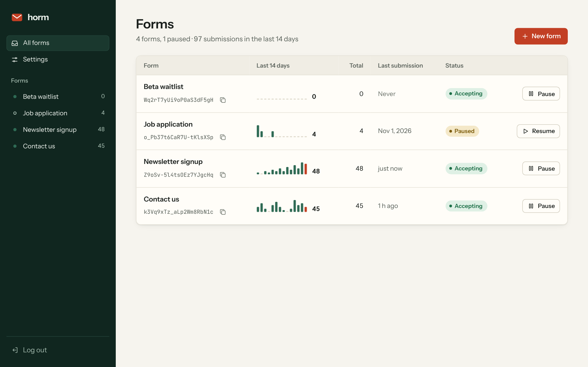
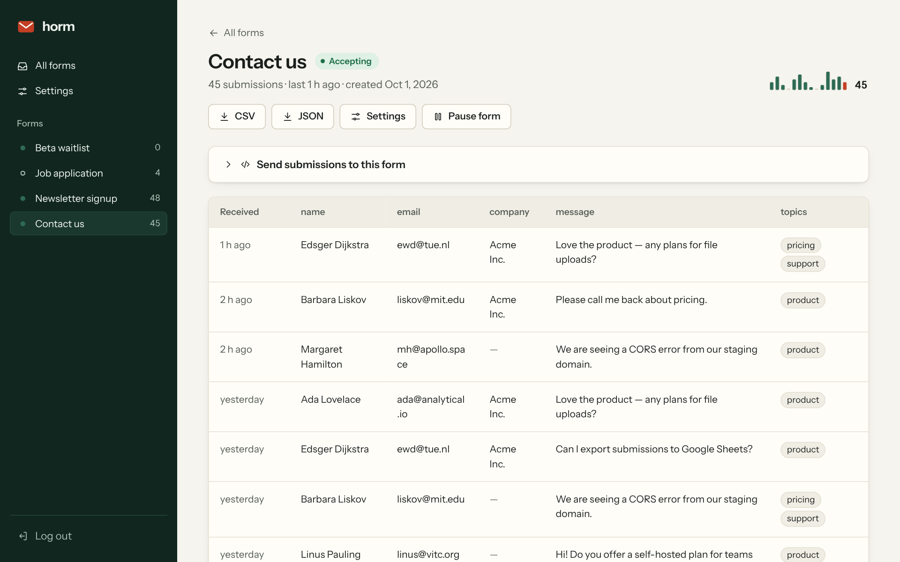
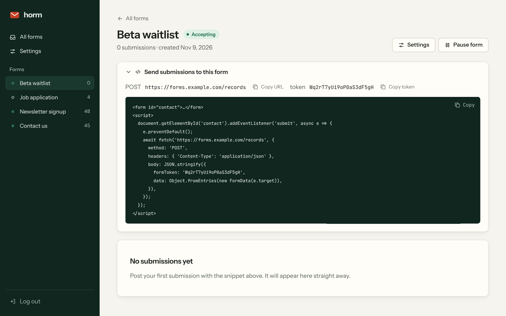
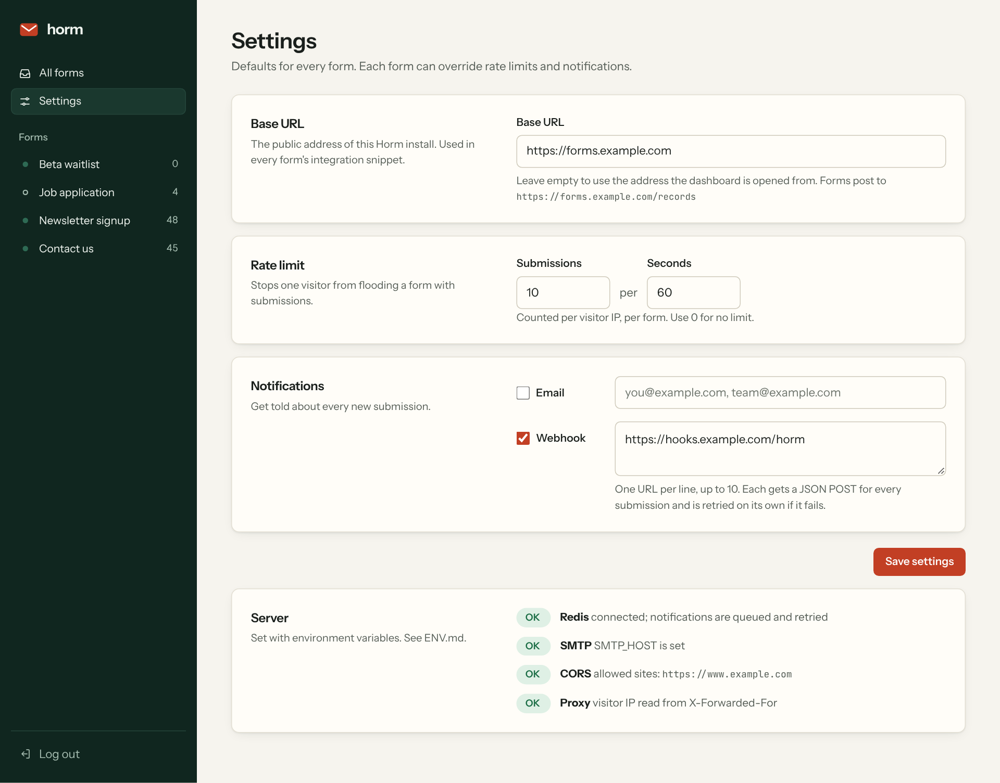
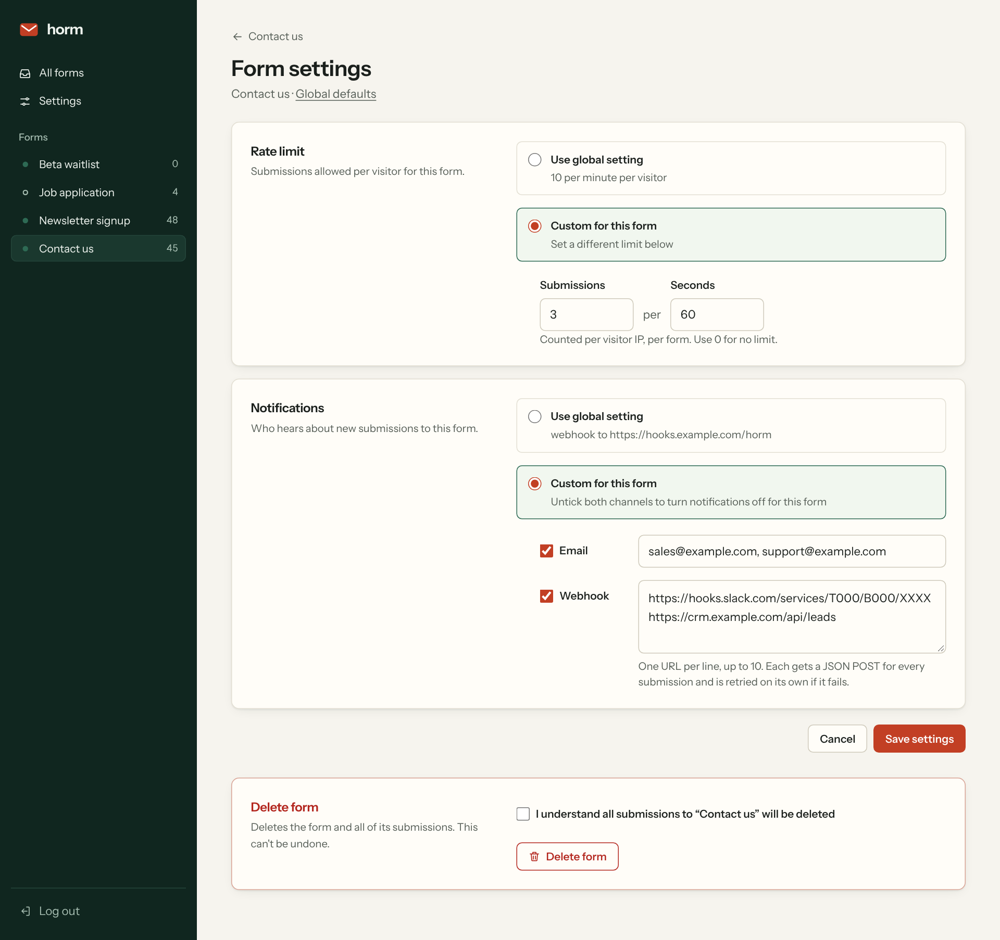
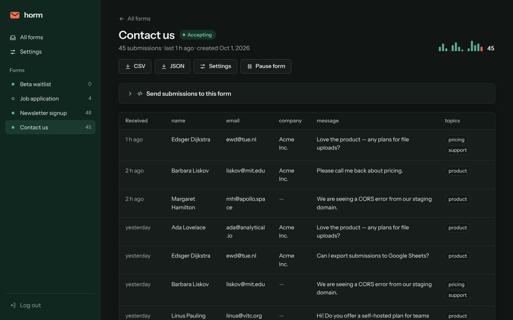
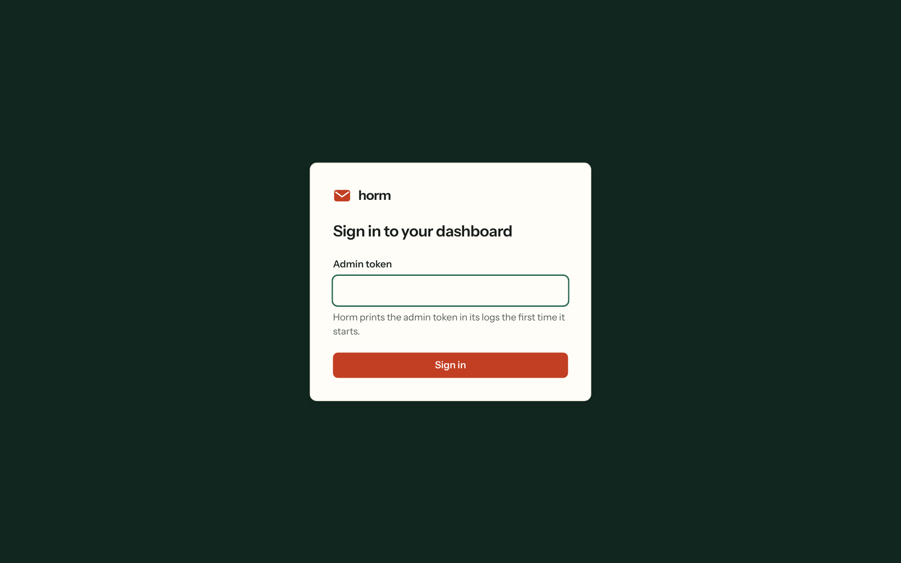
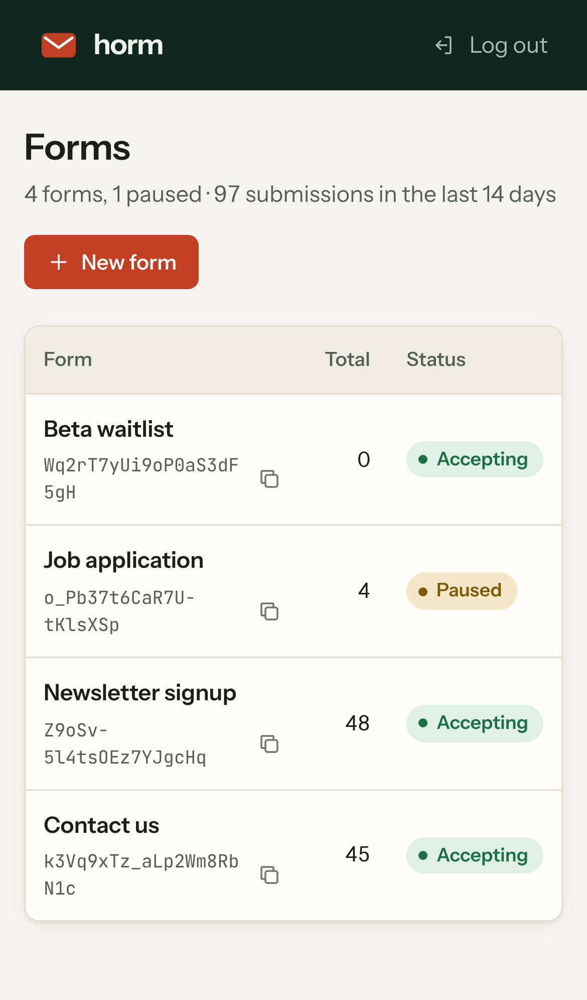

# Horm

> A self-hosted backend for HTML forms.

Horm stores the submissions from your website's forms on your own server. Create a form in the dashboard, paste the
snippet into your site, and every submission lands in Horm: browse them, export them as CSV or JSON, and get an email or
webhook for each one. It is a single small service (Bun + SQLite) that deploys to Coolify or any Docker host in a few
minutes.



## Contents

- [Features](#features)
- [Screenshots](#screenshots)
- [Quick start](#quick-start)
  - [Coolify](#coolify)
  - [Docker Compose](#docker-compose)
  - [Docker (single container)](#docker-single-container)
  - [From source](#from-source)
- [Sending submissions from your website](#sending-submissions-from-your-website)
- [Dashboard](#dashboard)
- [Settings](#settings)
- [Notifications](#notifications)
- [Rate limiting, CORS and limits](#rate-limiting-cors-and-limits)
- [Configuration](#configuration)
- [REST API](#rest-api)
- [Data and backups](#data-and-backups)
- [Security notes](#security-notes)
- [Development](#development)
- [License](#license)

## Features

- **Self-hosted**: your submissions stay on your server, in a single SQLite file.
- **Dashboard**: create, pause, resume and delete forms; browse submissions in a table with one column per field,
  paginated; export everything as CSV or JSON. Light and dark themes, works on phones.
- **Copy-paste integration**: every form shows a ready-made snippet with your public URL and its token.
- **Notifications**: email and/or **multiple webhooks** per form, delivered through a queue with retries and
  exponential backoff. Each destination retries on its own, so one broken endpoint never blocks the others.
- **Per-form settings**: each form can use the global defaults or override its rate limit and notifications.
- **Spam protection**: per-visitor rate limiting, request size limit and CORS allow-list.
- **REST API**: everything the dashboard does for forms and submissions is also available over HTTP, with an
  admin token.
- **Easy to deploy**: one Dockerfile, a Coolify-ready `docker-compose.yaml`, no external database. Redis is optional and
  only needed for notifications.

## Screenshots

| Submissions | Integration snippet |
| --- | --- |
|  |  |

| Global settings | Form settings |
| --- | --- |
|  |  |

| Dark mode | Sign in | Phone |
| --- | --- | --- |
|  |  |  |

## Quick start

Horm needs one required setting, **`ADMIN_TOKEN`**: the token you sign in to `/dashboard` with and send as the
`Authorization` header for the API. Use at least 16 random characters and keep it secret:

```bash
openssl rand -hex 24
```

Horm refuses to start without it. To rotate it, change the variable and restart; the old token stops working.

### Coolify

1. In Coolify, create a new resource from this Git repository and choose the **Docker Compose** build pack. The default
   compose location `/docker-compose.yaml` is correct.
2. In *Environment Variables*, set `ADMIN_TOKEN` (required).
3. Deploy. Coolify generates a domain for the app and a password for Redis automatically.
4. Visit `https://<your-domain>/dashboard` and sign in.
5. Optional: in *Environment Variables*, set `SMTP_*` to send emails and `CORS` to limit which sites may post
   (see [Configuration](#configuration)).

Data is kept in the `horm-data` volume (`/app/data/horm.sqlite`). The base URL used in form snippets defaults to the
Coolify domain and can be changed in **Dashboard → Settings**.

### Docker Compose

```bash
git clone https://github.com/codevry/horm.git
```

```bash
cd horm
```

```bash
cp .env.docker.example .env
```

Set `ADMIN_TOKEN` in `.env`, then:

```bash
docker compose up -d
```

The app listens on <http://localhost:9988> (change it with `PORT` in `.env`). `docker-compose.override.yml` is picked up
automatically for local runs: it publishes the port and turns `TRUST_PROXY` off because no proxy sits in front.

### Docker (single container)

```bash
docker build -t horm .
```

```bash
docker run -d --name horm -p 9988:9988 -v horm-data:/app/data -e ADMIN_TOKEN=your-long-secret-token -e REDIS_URL=redis://your-redis:6379 horm
```

Leave out `REDIS_URL` if you don't need notifications. Put a reverse proxy with HTTPS in front for production and set
`TRUST_PROXY=true` so rate limiting sees the real visitor IP.

### From source

Requirements: [Bun](https://bun.com/) 1.2+, and optionally Redis for notifications.

```bash
bun install --frozen-lockfile --production
```

```bash
cp .env.source.example .env
```

Set `ADMIN_TOKEN` in `.env`.

```bash
bun start
```

The SQLite database is created at `data/horm.sqlite` (change with `SQLITE_PATH`).

## Sending submissions from your website

Add `data-horm="<form token>"` to any form and paste this script once, after your forms. Replace the URL with your Horm
address. That's it:

```html
<form data-horm="Wq2rT7yUi9oP0aS3dF5gH">
  <input name="email" type="email" required />
  <textarea name="message"></textarea>
  <button>Send</button>
</form>

<script>
  document.querySelectorAll('form[data-horm]').forEach(f => f.onsubmit = e => {
    e.preventDefault();
    fetch('https://forms.example.com/records', { method: 'POST', body: JSON.stringify({ formToken: f.dataset.horm, data: Object.fromEntries(new FormData(f)) }) }).then(() => f.reset());
  });
</script>
```

The dashboard shows this snippet with your URL and token filled in (**Send submissions to this form**). One script
handles every form on the page, each with its own token. Every field `name` becomes a column in the dashboard.

Under the hood it is a plain `POST /records` with a JSON body, so you can send it from anywhere:

```json
{ "formToken": "Wq2rT7yUi9oP0aS3dF5gH", "data": { "email": "ada@example.com", "message": "Hello!" } }
```

`data` can hold any fields, including arrays and nested objects.

Responses:

| Case | HTTP | Body |
| --- | --- | --- |
| Saved | `200` | `{ "status": true, "message": "Record saved successfully", "data": { … } }` |
| Unknown or paused form | `200` | `{ "status": false, "message": "…", "error": "Form is disabled…" }` |
| Not JSON | `400` | `{ "status": false, "message": "Invalid JSON body" }` |
| Too large | `413` | `{ "status": false, "message": "Submission too large" }` |
| Rate limited | `429` | `{ "status": false, "message": "Too many submissions", "error": "… Try again in 42 seconds." }` |

Always check `status` in the body: business errors return HTTP 200 with `status: false`.

## Dashboard

Open `/dashboard` and sign in with the admin token. The session is an HTTP-only, `SameSite=Strict` cookie valid for
7 days.

- **All forms**: every form with its token (click to copy), a 14-day bar chart of submissions per day (today in red),
  totals, time of the last submission, status and a pause/resume button.
- **Form page**: the submissions table (50 per page, newest first), **CSV** and **JSON** export of all submissions,
  the integration snippet, pause/resume, and a link to the form's settings.
- **New form**: give it a name; you are taken straight to its page with the token and snippet.
- **Pause** a form to reject new submissions without deleting anything. **Delete** (in form settings, with
  confirmation) removes the form and all of its submissions.

## Settings

### Global settings (Dashboard → Settings)

| Setting | What it does |
| --- | --- |
| **Base URL** | The public address of this install, e.g. `https://forms.example.com`. Used in every form's snippet. Empty means "the address the dashboard is opened from". |
| **Rate limit** | Default number of submissions each visitor may send to a form per time window (`0` = unlimited). |
| **Notifications** | Default email recipients (comma-separated) and webhook URLs (one per line, up to 10), each switched on or off. |
| **Server** | Read-only status of Redis, SMTP, CORS and the proxy setting, which are configured with environment variables. |

### Form settings (form page → Settings)

For **rate limit** and **notifications** separately, choose **Use global setting** or **Custom for this form**.
A custom notification setting with both channels unticked turns notifications off for that form.

### Precedence

```text
form's custom setting  →  global setting saved in the dashboard  →  environment variable  →  built-in default
```

Environment variables (`BASE_URL`, `RATE_LIMIT_*`, `NOTIFY_*`) only provide the starting values; once you save the
settings page, the dashboard values are used.

## Notifications

When a submission is saved, Horm queues one job per destination: one for the email recipients and one for **each**
webhook URL. Jobs are processed in the background by a BullMQ worker, so the visitor never waits for them.

- **Retries**: a failed delivery is retried `NOTIFY_ATTEMPTS` times (default 5), waiting `NOTIFY_RETRY_DELAY` seconds
  (default 30) before the first retry and doubling each time (30 s, 1 min, 2 min, 4 min…).
- **Configuration errors** (no SMTP server, missing recipient) fail once with a clear message instead of retrying.
- **Clean-up**: finished jobs are removed after a day, failed ones after a week.
- **Requires Redis** (`REDIS_URL`). Without it, submissions are still saved but no notifications are sent; the
  settings page shows a warning.

### Webhook payload

Each webhook receives a `POST` with `Content-Type: application/json`. Any 2xx response counts as delivered.

```json
{
  "jobId": "1",
  "jobName": "sendRecordNotification",
  "record": {
    "id": 97,
    "data": { "email": "ada@example.com" },
    "createdAt": "2026-11-10T16:27:54.017Z",
    "form": "Z9oSv-5l4tsOEz7YJgcHq"
  },
  "form": {
    "id": 2,
    "name": "Newsletter signup",
    "token": "Z9oSv-5l4tsOEz7YJgcHq",
    "createdAt": "2026-10-11T16:27:50.924Z",
    "isActive": true
  }
}
```

### Email

Emails are sent through your SMTP server (`SMTP_HOST`, `SMTP_PORT`, `SMTP_USER`, `SMTP_PASS`, `SMTP_FROM`,
`SMTP_SECURE`) with the subject `New record created in form: <form name>` and a table of the submission.

## Rate limiting, CORS and limits

- **Rate limit**: counted per visitor IP **and** per form in a fixed window, using the form's effective setting
  (default 10 per 60 s). Over the limit, Horm answers `429` with `Retry-After` and `RateLimit-Limit`,
  `RateLimit-Remaining`, `RateLimit-Reset` headers. Counters live in Redis when configured (shared by every instance)
  and in memory otherwise. If Redis is unreachable, submissions are let through rather than blocked.
- **Visitor IP behind a proxy**: set `TRUST_PROXY=true` when Horm runs behind a reverse proxy (Coolify/Traefik, nginx,
  Caddy). Horm then uses the last `X-Forwarded-For` entry, the one added by your proxy, so visitors can't dodge the
  limit by sending their own header. The Coolify compose file sets this for you.
- **CORS**: `CORS=*` (default) lets any website post to `/records`. Set a comma-separated list such as
  `CORS=https://www.example.com,https://example.com` to allow only your sites; browsers on other sites are blocked.
  The browser's preflight (`OPTIONS`) request is answered, and the rate-limit headers are readable by your page.
- **Size limit**: request bodies over `MAX_SUBMISSION_KB` (default 100 KB) are rejected with `413`.

## Configuration

`ADMIN_TOKEN` is required; everything else is optional. For Docker Compose and Coolify see also [ENV.docker.md](ENV.docker.md); for running from
source see [ENV.md](ENV.md).

| Variable | Default | Description |
| --- | --- | --- |
| `ADMIN_TOKEN` | **required** | Admin token for the dashboard and API (min 16 chars). |
| `PORT` | `9988` (Docker) | Port the server listens on. |
| `SQLITE_PATH` | `data/horm.sqlite` | SQLite database file (created if missing). |
| `BASE_URL` | Coolify domain | Public URL used in form snippets. Can be changed in the dashboard. |
| `REDIS_URL` | – | Redis connection URL. Enables notifications and shared rate-limit counters. |
| `CORS` | `*` | Sites allowed to post submissions: `*` or a comma-separated list of origins. |
| `TRUST_PROXY` | `false` (`true` in Coolify compose) | Read the visitor IP from `X-Forwarded-For`. |
| `RATE_LIMIT_MAX` | `10` | Default submissions per visitor per form per window (`0` = off). |
| `RATE_LIMIT_WINDOW` | `60` | Default rate-limit window in seconds. |
| `MAX_SUBMISSION_KB` | `100` | Largest accepted submission body. |
| `NOTIFY_CHANNELS` | – | Default channels: `email`, `webhook` or `email,webhook`. |
| `NOTIFY_EMAIL` | – | Default email recipients, comma-separated. |
| `NOTIFY_WEBHOOK` | – | Default webhook URLs, comma-separated. |
| `NOTIFY_ATTEMPTS` | `5` | Tries per notification before giving up. |
| `NOTIFY_RETRY_DELAY` | `30` | Seconds before the first retry; doubles each time. |
| `SMTP_HOST` | – | SMTP server. Required for email notifications. |
| `SMTP_PORT` | `587` | SMTP port. |
| `SMTP_USER` / `SMTP_PASS` | – | SMTP credentials (leave empty for no auth). |
| `SMTP_FROM` | – | Sender address. |
| `SMTP_SECURE` | `false` (compose) | `true` for implicit TLS (usually port 465). |
| `SERVICE_PASSWORD_REDIS` | generated by Coolify | Redis password inside the compose stack. |

## REST API

All admin endpoints need `Authorization: Bearer <admin token>`. The full specification is in
[openapi.yaml](openapi.yaml); paste it into [Swagger Editor](https://editor.swagger.io/) for an interactive view.

| Method | Path | Auth | Description |
| --- | --- | --- | --- |
| `POST` | `/records` | public | Submit to a form: `{ "formToken": "…", "data": { … } }` |
| `GET` | `/records/form/{formToken}` | admin | Submissions of a form, newest first. Optional `?limit=1-500&page=N` adds `pagination: { page, limit, total, pages }`. |
| `POST` | `/forms` | admin | Create a form: `{ "name": "Contact us" }` |
| `GET` | `/forms` | admin | List forms. |
| `PUT` | `/forms/active` | admin | Resume a form: `{ "formToken": "…" }` |
| `PUT` | `/forms/disable` | admin | Pause a form: `{ "formToken": "…" }` |
| `DELETE` | `/forms` | admin | Delete a form and its submissions: `{ "formToken": "…" }` |
| `GET` | `/health` | public | Health check. |

Example:

```bash
curl -H "Authorization: Bearer $HORM_TOKEN" "https://forms.example.com/records/form/Wq2rT7yUi9oP0aS3dF5gH?limit=50&page=1"
```

## Data and backups

Everything lives in one SQLite database (in WAL mode) at `SQLITE_PATH`, `/app/data/horm.sqlite` in Docker. Tables:
`users`, `forms` (including per-form settings), `records` and `settings`. New columns are added automatically when you
upgrade.

To back up a running instance, use SQLite's online backup so the copy is consistent:

```bash
docker compose exec app bun -e "require('bun:sqlite').Database.open('/app/data/horm.sqlite').exec(\"VACUUM INTO '/app/data/backup.sqlite'\")"
```

```bash
docker compose cp app:/app/data/backup.sqlite ./horm-backup.sqlite
```

Redis only holds the notification queue and rate-limit counters, so it doesn't need a backup.

## Security notes

- The admin token is the only credential. Store it like a password; anyone with it can read every submission.
- The dashboard requires sign-in, uses an HTTP-only `SameSite=Strict` cookie (marked `Secure` behind HTTPS) and rejects
  cross-site form posts.
- All submitted values are HTML-escaped in the dashboard, and CSV exports neutralise spreadsheet formulas.
- Serve Horm over HTTPS (Coolify does this for you).
- SMTP credentials and CORS are configured only through environment variables, never stored in the database.

## Development

```bash
bun install
```

```bash
bun run dev
```

```bash
bunx tsc --noEmit -p .
```

```bash
bunx prettier --write src
```

Project layout:

```text
src/
  index.ts              entry point (Bun server)
  routes/               HTTP routes: forms, records, dashboard
  controller/           forms, records, settings logic
  database/dbInit.ts    SQLite schema, migrations, admin user
  mq/                   notification queue (BullMQ) and worker
  views/                server-rendered dashboard (HTML strings, CSS, fonts, icons)
  utils/                auth, rate limiting, redis, HTML escaping, CSV export
```

Releases use [commit-and-tag-version](https://github.com/absolute-version/commit-and-tag-version): `bun run release`.

## License

[MIT](LICENSE.txt) © CODEVRY LABS
